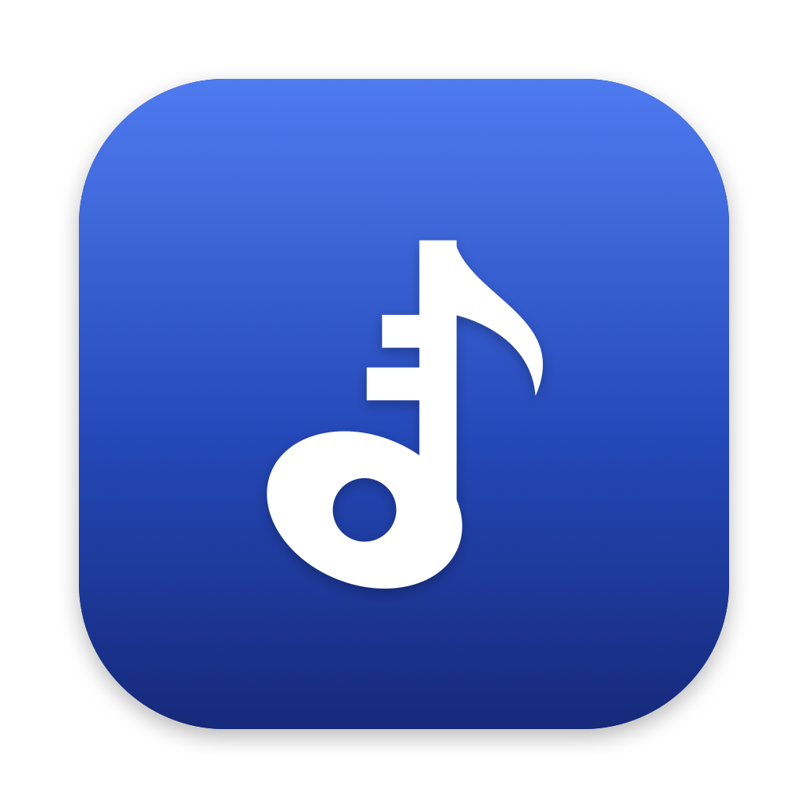

#  1PassChime

A tiny macOS menu bar app that plays a sound when **1Password asks for approval** — for example when `ssh`, `git` or the `op` CLI (or an AI coding agent running them) wants to use a key from the 1Password SSH agent or sign in to the CLI.

The approval window is easy to miss, especially when it opens on another display. 1PassChime chimes until you answer it, and its menu bar icon turns red while a request is waiting.

> **Unofficial.** Not affiliated with, endorsed by, or sponsored by 1Password (AgileBits Inc.). 1Password is a trademark of AgileBits Inc.

## What it does

- Watches for 1Password's approval window and plays a sound as soon as it appears.
- **Repeat until answered** (default): plays again every few seconds (2–20 s, default 3 s) until you approve or deny. Or **play once**.
- Menu bar icon: a note that is also a key. It follows the menu bar's light or dark look, and turns **red** while a request is waiting.
- Sounds: a built-in chime, any macOS alert sound, or an audio file of your own (AIFF, WAV, MP3, M4A, CAF). Its volume is a share of your Mac's output volume: the right end of the slider plays at the Mac's volume (the default), anything left of it is quieter.
- Menu: **Stop Sound for This Request** (a new request chimes again), **Play Sound**, **Pause Sounds**, Settings, Quit.
- Opens at login (turned on at first launch; switch it off in Settings).
- Languages: English, 日本語, 繁體中文, 简体中文, 한국어, Français, Deutsch, ไทย, Português (Brasil), Bahasa Indonesia, Español, Русский and Tiếng Việt. Automatic follows your macOS languages, or choose one in Settings.

## Install

Requires macOS 14 or later (Apple silicon or Intel) and the 1Password 8 app. No sudo or Homebrew.

```sh
curl -fsSL https://raw.githubusercontent.com/YusukeIt0/1pass-chime/main/install.sh | sh
```

The installer picks your CPU's build from the latest GitHub Release, checks its SHA-256 checksum and code signature, installs it to `~/Applications`, and starts it.

> Builds are currently **not notarized by Apple** (no Developer ID signing yet). The checksum and signature checks above confirm the download is intact.

**Updates:** about once a day the app checks this repository's releases. When a newer version exists, the menu and Settings show **Update**, which installs it and keeps your settings.

**Uninstall:**

```sh
curl -fsSL https://raw.githubusercontent.com/YusukeIt0/1pass-chime/main/install.sh | sh -s -- --uninstall
```

## How it works

Twice a second the app looks at the list of windows on screen, which macOS shares with every app without any permission: which app owns each window, its level and its size. 1Password's approval window is a 1Password window on the pop-up level, about 400 points wide. The main window sits on another level and Quick Access is much wider. 1Password's menu bar panel looks almost the same as an approval window, so the app also notes whether a mouse click just landed in a menu bar: a window that opens right after such a click is the panel you opened yourself, and it stays quiet.

- **No permissions**: no Accessibility, Screen Recording or Keychain access is requested. Of your mouse clicks, only whether one landed in a menu bar is used; keystrokes are never observed.
- **Nothing is read from 1Password**: no vault data, item names or window contents. The app never talks to 1Password.
- **No servers of its own, no analytics.** Its only network request is the daily update check against this repository's releases.
- Stored: your preferences in the app's defaults. The update log goes to `~/Library/Application Support/1PassChime/`.

These window details come from 1Password 8.12 on macOS 27. If a 1Password update changes the approval window, detection may need an update here; please open an issue.

## Build from source

```sh
swift test                  # unit tests
scripts/build-app.sh        # dist/1PassChime.app + per-arch zips + SHA256SUMS
scripts/release.sh          # tag and publish a GitHub Release (maintainers)
scripts/make-icon.sh        # regenerate the app icon from the mark drawn in code
```

Swift 5.10+ / Xcode 16+. Set `SIGN_IDENTITY` to a Developer ID Application identity to sign; otherwise builds are ad-hoc signed.

Developer aids:

- `"dist/1PassChime.app/Contents/MacOS/OnePassChime" --watch 60` prints what the watcher sees for 60 seconds. Run from a terminal it gets the terminal's permissions, so it may see window titles the app itself doesn't.
- `--render-icons <folder>` writes the app icon and menu bar images.
- To try a build without adding it to Login Items: `open -n --env ONEPASSCHIME_NO_LOGIN_ITEM=1 dist/1PassChime.app`. Add `--env ONEPASSCHIME_EVENT_LOG=<file>` to log what it sees and when it plays.

### Code layout

| Folder | Contents |
|---|---|
| `Sources/ChimeCore` | Platform-independent logic: which windows are approval prompts, when to play, the built-in chime, the mark, languages, update checks. Unit-tested |
| `Sources/OnePassChime` | The app: window watcher, sound player, menu bar item, Settings |
| `Resources/Languages` | One JSON file per language |

### Adding a language

Each language is one file, `Resources/Languages/<code>.json`; nothing in the code lists languages. Copy `en.json` and change `code` (same as the file name), `name` (the language's own name), `locale`, `order` (position in the picker), `matches` (macOS language tags it serves) and every entry in `strings`, keeping each `{placeholder}`. `swift test` fails if a file misses a key, has empty text, changes a placeholder, or claims a tag another language already serves.

## License

MIT
